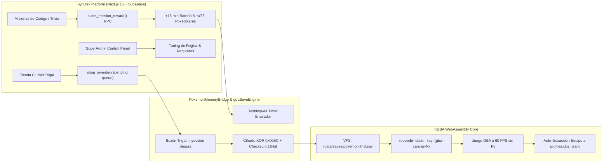

# 🗺️ Master Blueprint & Arquitectura: SynDex Cyber-Johto

Este documento es la **Fuente Única de Verdad (SSOT)** y mapa integral de ingeniería para el MVP de SynDex, integrando la plataforma educativa Next.js 15, la base de datos Supabase y la emulación GBA WebAssembly de *Pokémon Heart & Soul* (`pokemonHnS`).

---

## 🏗️ 1. Arquitectura del Sistema: Doble Motor "Code-to-Play"

---

## 🏛️ 2. Mapeo Binario Flash GBA (.sav 128 KB)

- **Estándar:** Flash 1Mbit (131,072 bytes) con Ring Buffer rotativo de 32 sectores (4,096 bytes c/u).
- **Slots:** Slot A (Sectores 0-13) y Slot B (Sectores 14-27). El Slot Activo es aquel cuyos 14 sectores tengan firma `0x08012025` y el `saveCounter` más alto en `0x0FFC`.

### Tabla de Sectores Lógicos
| Section ID | Nombre Lógico | Tamaño Checksum (`SECTION_SIZES`) | Contenido Clave |
| :---: | :--- | :---: | :--- |
| **0** | `SaveBlock2` | `0x0F2C` (3,884 B) | Nombre, TID/SID, **`encryptionKey` u32 en `0x00BC`**, opciones Shiny. |
| **1** | `SaveBlock1 Pt 1` | `0x0F80` (3,968 B) | `partyCount` (`0x0234`), `partyData` (`0x0238`), Dinero (`0x0490`), Mochila (`0x0560`). |
| **2-4** | `SaveBlock1 Pt 2-4`| `0x0F80` / `0x0F08` | Flags de eventos de Johto, medallas, variables de historia. |
| **5-13** | `PokemonStorage` | `0x0F80` (Pt 1-8), `0x07D0` (Pt 9) | PC Boxes (Sector 5: `currentBox` en `0x0000`, Box 1 en `0x0004` con 30 slots * 80 B). |

---

## 🔑 3. Cifrado XOR y Checksums Oficiales

1. **Dinero en SaveBlock1:**
   $$\text{Dinero Real} = \text{Valor en } 0x0490 \oplus \text{encryptionKey (0x00BC)}$$
2. **Cantidad de Ítems en Mochila (u16):**
   $$\text{Cantidad Real} = \text{Valor en } \text{slot}+2 \oplus (\text{encryptionKey} \ \& \ \text{0xFFFF})$$
3. **Estructura Pokémon (100 bytes en Party / 80 bytes en PC Box):**
   - Subestructuras (Growth, Attack, EVs, Misc) de 12 bytes permutadas por $\text{PID} \pmod{24}$.
   - Checksum de 16 bits sobre los 48 bytes descifrados almacenado en offset `0x1C`.
   - Cifrado de las subestructuras con llave $K = \text{PID} \oplus \text{OTID}$.
4. **Fórmula Oficial de Checksum de Sector (pokeemerald):**
   $$\text{Checksum} = \left(\sum \text{words u32} \gg 16\right) + \left(\sum \text{words u32} \ \& \ \text{0xFFFF}\right)$$
   Guardado en `sectorBase + 0x0FF6`.

---

## 🛡️ 4. Ecosistema de las 6 Pantallas del MVP

1. **`/` (Portada):** "Encuentro Salvaje de 3 Minutos" vs Rival IA ('Código Silver') con captura de prospectos a WhatsApp Business.
2. **`/onboarding`:** Supabase Auth, Test de Naturaleza (Cyndaquil/Totodile/Chikorita) y regalo inicial de ₽50.
3. **`/dashboard`:** Mapa interactivo de Johto (Nivel 1 Medalla Céfiro, 2-12 bloqueados) + Pokégear Socrático.
4. **`/play`:** Sala Dual: Pestaña 1 (Trivia Visual, Conector de Cables, Bug Hunt) + Pestaña 2 (`<GbaConsoleWorker/>`).
5. **`/league`:** Ranking en vivo por Supabase Realtime con sprites y Tienda de Ciudad Trigal.
6. **`/arena`:** Sala en vivo para Sábados y Estudio TikTok con rostro reactivo `AiRivalFace.tsx` y Ataque de 3 Cables.

---

## ⚙️ 5. Módulo SuperAdmin ("Torre de Control")

Diseño de control manual y automático para el profesor:
- **Modo Manual:** Habilitar/deshabilitar candados de nivel o inyectar batería/Pokémon directamente a un alumno por su ID.
- **Modo Automático:** Reglas dinámicas en PostgreSQL/Supabase (`admin_game_rules`) que condicionan las puertas de Johto al progreso académico.
